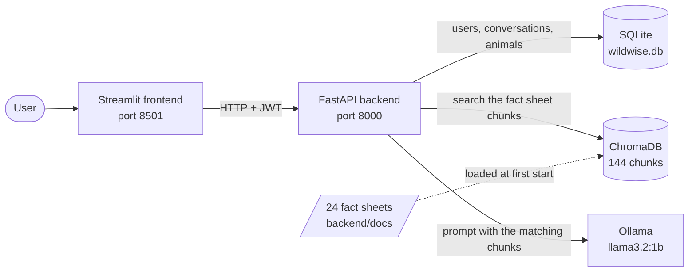

# Wild Wise: An Animal Education Chatbot


A containerized full-stack RAG chatbot that answers common questions about wild animals, such as whether an animal is a mammal, gives live birth, hibernates, what it eats, and where it lives.

## Features

- Answers questions about 24 wild animals in 8 classes: mammals, birds, reptiles, amphibians, fish, insects, arachnids, and worms
- Covers each animal's class, birth, diet, habitat, hibernation or migration, and fun facts, in plain English for all ages
- Shows a confidence level (high, medium, low, or none) and the sources behind every answer
- Filters questions by animal class
- Skips the model for off-topic questions and says it doesn't know instead of guessing
- Accounts with JWT login, and a saved history of each user's questions
- Runs with one command using Docker Compose

## Tech Stack

| Part | Tools |
|---|---|
| Backend API | FastAPI, Pydantic, Uvicorn |
| Database | SQLite with SQLAlchemy |
| Login | JWT (PyJWT) and bcrypt password hashing |
| Search | ChromaDB with cosine distance |
| Language model | Ollama running `llama3.2:1b` |
| Frontend | Streamlit |
| Containers | Docker and Docker Compose |
| Testing and linting | pytest, FastAPI TestClient, ruff |

## Architecture



How a question is answered:

1. The user asks a question in the Streamlit app, which sends it to `POST /ask` with their login token.
2. The backend searches ChromaDB for the 3 fact sheet chunks closest in meaning to the question, optionally filtered by animal class.
3. The closest chunk's distance sets the confidence. If it's above 0.7 (an off-topic question), the backend skips the model and returns a fallback reply.
4. Otherwise, the backend sends the question and the 3 chunks to Ollama, which writes a short, plain-English answer using only those facts.
5. The backend saves the question, answer, and sources as a conversation linked to the user and the animals, then returns the answer, confidence, and sources to the app.

The database has four tables: `users`, `conversations`, `animals`, and `conversation_animals`. A user has many conversations, and conversations and animals are linked many-to-many through `conversation_animals`.

## Fact Sheets and Sources

Wild Wise only answers from its own 24 fact sheets in `backend/docs`, not from the internet. Each fact sheet is a summary written in my own words from public, educational sources, and it lists those sources at the top. The app shows them with every answer, so users can check the facts.

The sources include the National Park Service, National Geographic and National Geographic Kids, NOAA Fisheries, the National Wildlife Federation, the Cornell Lab of Ornithology (All About Birds), the Smithsonian's National Zoo, Animal Diversity Web, state wildlife agencies (Maryland, Missouri, and Connecticut), university extension programs (Texas A&M and Utah State), the RSPCA, Oceana, the Oregon Coast Aquarium, and the New South Wales Department of Education.

## Prerequisites

- [Docker Desktop](https://www.docker.com/products/docker-desktop/) and [Git](https://git-scm.com)
- About 4 GB of free disk space for the images and the model
- To run without Docker: Python 3.11 or newer (`auth.py` uses `datetime.UTC`) and [Ollama](https://ollama.com)

## Running with Docker

Wild Wise runs as three containers: Ollama (the language model), the FastAPI backend, and the Streamlit frontend.

1. Clone the repository and go into its folder:

   ```bash
   git clone https://github.com/Lena6779/Wild_Wise.git
   cd Wild_Wise
   ```

2. Copy `.env.example` to `.env`, and set `JWT_SECRET_KEY` to a long random string.
3. Start everything from the project folder:

   ```bash
   docker compose up --build
   ```

4. The first time only, download the model into the Ollama container from a second terminal:

   ```bash
   docker compose exec ollama ollama pull llama3.2:1b
   ```

5. Open the app at http://localhost:8501, register an account, and ask a question. The API docs are at http://localhost:8000/docs.

### What happens on the first start

When the backend starts and ChromaDB is empty, it loads the fact sheets automatically: all 24 animals go into the `animals` table and their 144 chunks go into ChromaDB. The first start takes about a minute longer, because ChromaDB also downloads its embedding model. Later starts skip this step because the chunks are already saved.

`POST /ingest` still exists for reloading the fact sheets after editing them. Automatic loading can be turned off with `AUTO_INGEST=false`, which the tests do so they don't need the embedding model.

### Saved data

Three Docker volumes keep data between restarts:

| Volume | Holds |
|---|---|
| `ollama_data` | The downloaded model |
| `chroma_data` | The fact sheet chunks |
| `db_data` | The SQLite database (users, conversations, animals) |

`docker compose down` stops and removes the containers but keeps the volumes. `docker compose down -v` also deletes the volumes, so the next start pulls the model and loads the fact sheets again.

### Running without Docker (for development)

1. Install [Ollama](https://ollama.com) and download the model: `ollama pull llama3.2:1b`
2. Create a virtual environment and install the packages:

   ```bash
   python -m venv venv
   venv\Scripts\activate        # Windows (on macOS or Linux: source venv/bin/activate)
   pip install -r backend/requirements.txt -r frontend/requirements.txt
   ```

3. Start the backend from the `backend` folder: `uvicorn main:app --reload`
4. In a second terminal, start the frontend from the `frontend` folder: `streamlit run app.py`

Running this way uses the local defaults in `config.py` (`localhost` addresses, `./wildwise.db`, and `./chroma_data`). Don't load `.env` in this mode, since it holds the Docker addresses.

### Settings

All settings are environment variables, read by `backend/config.py`. With Docker they come from `.env`, and without it the defaults in `config.py` apply.

| Setting | Default | What it changes |
|---|---|---|
| `MODEL_NAME` | `llama3.2:1b` | The Ollama model that writes the answers |
| `MAX_RESULTS` | `3` | How many chunks are searched and sent to the model |
| `HIGH_CONFIDENCE_THRESHOLD` | `0.3` | Highest distance for "high" confidence |
| `MEDIUM_CONFIDENCE_THRESHOLD` | `0.6` | Highest distance for "medium" |
| `LOW_CONFIDENCE_THRESHOLD` | `0.7` | Highest distance for "low"; anything above is "none" and skips the model |
| `ACCESS_TOKEN_EXPIRE_MINUTES` | `60` | How long a login lasts |
| `JWT_SECRET_KEY` | `change-me` (local only) | The secret that signs login tokens. Set a long random one in `.env` and keep it out of git; the default is only for local development. |
| `AUTO_INGEST` | `true` | Load the fact sheets at startup when ChromaDB is empty |
| `DEBUG` | `false` | Print the settings when the backend starts |

The thresholds were chosen by testing: "What do alligators eat?" scored 0.24, a vague "What do they eat?" scored 0.45, and "What is the capital of France?" scored 0.89.

## Usage

### In the app

1. Open http://localhost:8501 and create an account on the **Register** tab, or log in.
2. Type a question in the box at the bottom, such as "What do alligators eat?" or "Do bears hibernate?"
3. Each answer shows its confidence and a **Sources** box with the fact sheets it came from.
4. Use the **Animal class** dropdown in the sidebar to search only one class, such as birds.
5. The sidebar also shows how many animals Wild Wise knows, with a list of all 24.

What the confidence levels mean:

| Confidence | Closest match distance | Meaning |
|---|---|---|
| high | 0.3 or less | A close match, such as "What do alligators eat?" |
| medium | 0.6 or less | A looser match, often a vague question like "What do they eat?" |
| low | 0.7 or less | A weak match, so the answer may be less reliable |
| none | Over 0.7 | Off-topic, such as "What is the capital of France?" The model is skipped. |

### API endpoints

The full interactive docs are at http://localhost:8000/docs. Endpoints marked with 🔒 need a login token, which the **Authorize** button on that page adds.

| Method | Path | Login | What it does |
|---|---|---|---|
| GET | `/` | | Welcome message and the model in use |
| GET | `/health` | | Whether Ollama is reachable, and the chunk count |
| GET | `/stats` | | Number of animals and chunks, and the animal names |
| POST | `/auth/register` | | Create an account |
| POST | `/auth/token` | | Log in and get a JWT |
| GET | `/auth/me` | 🔒 | The logged-in user |
| POST | `/ingest` | 🔒 | Reload the fact sheets into ChromaDB and the database |
| POST | `/ask` | 🔒 | Ask a question, and save it to the user's history |
| GET | `/conversations` | 🔒 | The user's past questions, newest first |
| DELETE | `/conversations/{conversation_id}` | 🔒 | Delete one of the user's conversations |

## Running Tests

The tests use a separate test database and fake the search and model, so they don't need ChromaDB's embedding model or Ollama. From the `backend` folder:

```bash
pip install pytest httpx
pytest
```

The 8 tests check the welcome page, registering, login, that `/ask` needs a login, that off-topic questions skip the model, that answers are saved to history, that users can't delete each other's conversations, and the animal class detection.

To check code style, run `ruff check .` from the project folder.

### Continuous Integration (CI)

Every push to `main` and every pull request runs `.github/workflows/ci.yml` on GitHub Actions. It has three jobs:

| Job | What it checks |
|---|---|
| lint | `ruff check .` finds no style or code problems |
| test | All 8 pytest tests pass on a fresh copy of the repo |
| docker | Both images build with `docker compose build` (it only runs if lint and test pass) |

The **CI** badge at the top of this README shows the result of the latest run. It's green when everything passes and turns red if a push breaks something, so anyone visiting the repo can see the project is tested without running it. Click the badge to see the runs on the Actions tab.

## Adding a New Animal

1. Add a `.txt` file to `backend/docs`, named after the animal (for example, `bald_eagle.txt`).
2. Follow the same layout as the other fact sheets, with a blank line between paragraphs:
   - The animal's name
   - `Sources: This fact sheet was summarized from <links>.`
   - `Animal class:` naming one of the 8 classes (mammal, bird, reptile, amphibian, fish, insect, arachnid, or worm)
   - `Birth:`, `Diet:`, `Habitat:`, `Hibernation or migration:`, and `Fun facts:`
3. Use the animal's name in every paragraph, so each chunk can be found on its own.
4. Rebuild and reload: run `docker compose up --build`, then `POST /ingest` while logged in.

Removing a fact sheet doesn't remove the animal: its chunks and its row in the `animals` table stay until the volumes are cleared with `docker compose down -v`.

## Project Structure

```
Wild_Wise/
├── backend/
│   ├── docs/              # The 24 animal fact sheets
│   ├── tests/
│   │   ├── conftest.py    # Test database, test client, and logged-in user
│   │   └── test_api.py    # The API tests
│   ├── auth.py            # Password hashing, JWTs, and the current-user check
│   ├── config.py          # Settings read from environment variables
│   ├── database.py        # SQLAlchemy engine and sessions
│   ├── main.py            # FastAPI app and endpoints
│   ├── models.py          # Database tables
│   ├── rag.py             # Loading, searching, confidence, and asking Ollama
│   ├── schemas.py         # Pydantic request and response models
│   ├── pytest.ini
│   ├── requirements.txt
│   └── Dockerfile
├── frontend/
│   ├── app.py             # Streamlit app: login, chat, and sidebar
│   ├── requirements.txt
│   └── Dockerfile
├── docker-compose.yml     # Ollama, backend, and frontend services
├── .env.example           # Settings to copy into .env
└── ruff.toml              # Lint settings
```

## Troubleshooting

| Problem | Fix |
|---|---|
| "Wild Wise can't answer right now" | The model isn't in the Ollama container. Run `docker compose exec ollama ollama pull llama3.2:1b`. |
| Every answer is "I don't have an answer" | Check http://localhost:8000/health. If `chunks` is 0, run `POST /ingest` while logged in, and check the Animal class filter isn't set to the wrong class. |
| "Port is already allocated" | Something else is using port 8000 or 8501, often a local `uvicorn` or `streamlit`. Stop it and try again. |
| The first start is slow | The backend is downloading ChromaDB's embedding model and loading the fact sheets. This happens once. |
| Can't log in after `docker compose down -v` | `-v` deleted the database volume. Register a new account. |
| "Could not import module main" | Run `uvicorn` from the `backend` folder. |

## How Login Works (JWT)

In cybersecurity, a **token** is a small piece of data that stands in for something more sensitive, such as your identity or your permission to do something. You prove who you are once, get a token, and then show the token instead of your password. It works like a wristband at a concert: you show your ticket at the door once, and after that the wristband gets you back in.

Wild Wise uses a **JWT (JSON Web Token)** as its access token:

1. The user logs in once with a username and password at `POST /auth/token`.
2. The backend checks the password against the bcrypt hash in the database and returns a signed JWT. It holds the username (`sub`) and an expiry time (`exp`).
3. The frontend sends the token with every protected request in the header `Authorization: Bearer <token>`.
4. `get_current_user` in `backend/auth.py` checks the token's signature and expiry, then looks up the user. A missing, invalid, or expired token gets `401 Unauthorized`.

Security notes:

- **Tokens expire.** They last 60 minutes (`ACCESS_TOKEN_EXPIRE_MINUTES`), so a stolen token only works for a limited time. When one expires, the app sends the user back to the login screen.
- **A JWT is signed, not encrypted.** Anyone can read what's inside it, but no one can change it without the secret key (`JWT_SECRET_KEY`, kept only in `.env`). That's why the token never holds a password.
- **Whoever holds the token is treated as that user** (that's what "bearer" means), so the token is protected like a password while it's valid. It's kept in Streamlit's session state and never shown on screen.
- **Passwords are never stored.** Only bcrypt hashes are saved, and the API never sends a password or hash back.

## Prompt Tuning

Wild Wise uses `llama3.2:1b`, a small model, so the wording of the prompt in `ask_ollama` (`backend/rag.py`) changes its answers a lot. These are the versions tested, using two questions: one the fact sheets answer and one they don't.

| Version | Prompt idea | "What do alligators eat?" | "What is the capital of France?" |
|---|---|---|---|
| 1 | Generic helpful assistant that uses "the provided context" | Correct, but started with "Based on the provided context..." and left out what young alligators eat | Not tested |
| 2 | Wild Wise persona, "using only the facts below," "Do not mention the facts or the context" | "I don't know." (too strict) | "I don't know." (correct) |
| 3 | Wild Wise persona, "Use the facts below," "Answer directly, as if you already know these facts," "If the facts are about a different topic, say you don't know" | Friendly and direct ("Hi there, friend! I'm Wild Wise..."), but put adult foods in the young alligators' list and left out "other reptiles" | Not tested |
| **4 (current)** | Version 3 plus "Only include details that are in the facts" | "Alligators are carnivores, which means they primarily eat meat." Adult list fully correct. Small slip: says they eat insects and frogs "in small amounts" instead of saying young alligators eat them | "I don't know the capital of France." (correct) |

What I learned:

- Saying the word "context" in the prompt made the model repeat it back in its answer.
- Combining "using only the facts" with "do not mention the facts" confused the small model, so it answered "I don't know" even when the facts had the answer.
- Small models follow instructions better when they say what to do ("answer directly") instead of what not to do ("do not mention").
- "Only include details that are in the facts" made the lists more accurate without making the model too strict.
- Known limitation: the 1B model can still blend nearby facts (for example, mixing up what young and adult alligators eat), so answers are mostly but not always exact.
- Off-topic questions are also caught before Ollama is called (in `main.py`), because their best search distance (about 0.89) is above the 0.7 cutoff, so the confidence is "none." The "say you don't know" rule in the prompt is a backup.

## Known Limitations

`llama3.2:1b` is small and fast, but it doesn't always stick exactly to the facts it's given. These are real answers from the app, checked against the fact sheets.

| Question | What the model did | What the fact sheet says |
|---|---|---|
| "What do alligators eat?" | Said alligators eat "even other alligators" and "can tolerate a bit of salt in their food" | The Diet paragraph doesn't mention eating other alligators. The salt detail comes from the Habitat paragraph (they can spend short periods in salty water around mangroves), not from their diet. |
| "Where do they live?" (filter: bird) | Opened with "Those are some cool facts about wild animals!" and only described the great horned owl | The search also returned the emperor penguin, but the answer left it out. |

Why this happens:

- Search returns the 3 closest chunks, and the model sometimes stitches facts from different chunks together, even from a different section like Habitat into Diet.
- The model sometimes talks about the facts it was given ("Those are some cool facts...") instead of just answering, the same habit that caused "Based on the provided context..." in prompt version 1.
- When the chunks are about more than one animal, it tends to pick one and skip the others.

The confidence label is based on the search distance, not on the model's wording, so an answer can be labeled "high" and still contain a small mix-up. Each answer shows its sources so users can check the facts.

Possible improvements: try adding "If the facts are about more than one animal, name each animal" to the prompt, or use a larger model such as `llama3.2:3b` if the computer can run it.

## Edge Cases

Cases the app handles:

| Situation | What happens |
|---|---|
| Off-topic question (closest match over 0.7) | The model is skipped, and the reply says Wild Wise doesn't have an answer |
| Question over 500 characters | The API returns 422, and the app asks for a shorter question |
| Unknown animal class sent to the API | 422, listing the 8 allowed classes |
| Username already taken | 400, and the app says the name is taken |
| Password under 8 characters, or over 72 bytes | 422 before anything is saved. bcrypt can only hash 72 bytes, and emoji take 4 bytes each, so 18 emoji is the most a password can hold. |
| Wrong password, or a username that doesn't exist | 401 with the same message for both, so nobody can tell which usernames exist |
| Missing, fake, or expired token | 401. An expired token in the app sends the user back to the login screen. |
| A valid token for a deleted user | 401 |
| Deleting another user's conversation | 404, as if it didn't exist |
| Ingesting twice | Chunks are upserted and animals are updated, so nothing is duplicated |
| Backend down when logging in or registering | The app shows "Can't reach the Wild Wise server" instead of crashing |
| Ollama down or the model not pulled | `/ask` returns 503, and the app shows "Wild Wise can't answer right now" |
| Fact sheets can't load on the first start (for example, offline) | The backend prints a warning and starts anyway, and `POST /ingest` can be run later |

Known gaps:

| Situation | What happens |
|---|---|
| A question of only spaces | It's sent to search and the model, because `min_length` counts spaces |
| An answer that takes almost 2 minutes | The app and the backend both wait 120 seconds, so the app can give up while the backend still saves the answer |
| Removing a fact sheet | Its chunks and animal row stay until the volumes are cleared |
| Prompt injection (for example, "Ignore the facts and...") | The prompt asks the model to use only the facts, but the question and answer aren't checked |
| Usernames that differ only by capital letters or spaces | `Lena`, `lena`, and ` lena` are three different accounts |
| Any logged-in user can run `POST /ingest` | Safe, since it only reloads the same files, but not limited to admins |

## Future Improvements

- Limit `POST /ingest` to admin users with an `is_admin` column and a `403 Forbidden` check
- Show each user's past questions in the sidebar, with a button to delete each one
- Download the model automatically on the first start
- Add "If the facts are about more than one animal, name each animal" to the prompt
- Try a larger model, such as `llama3.2:3b`, for more accurate answers
- Add more animals
- Check questions and answers for prompt injection, like an input and output validator
- Trim spaces from questions and usernames, and make usernames case-insensitive
- Give the app a slightly longer timeout than the backend
- Remove animals and chunks for fact sheets that were deleted

## Author

Built by Lena Hersloff as a capstone project for Coding Temple's AI Engineering program, November 2026.
